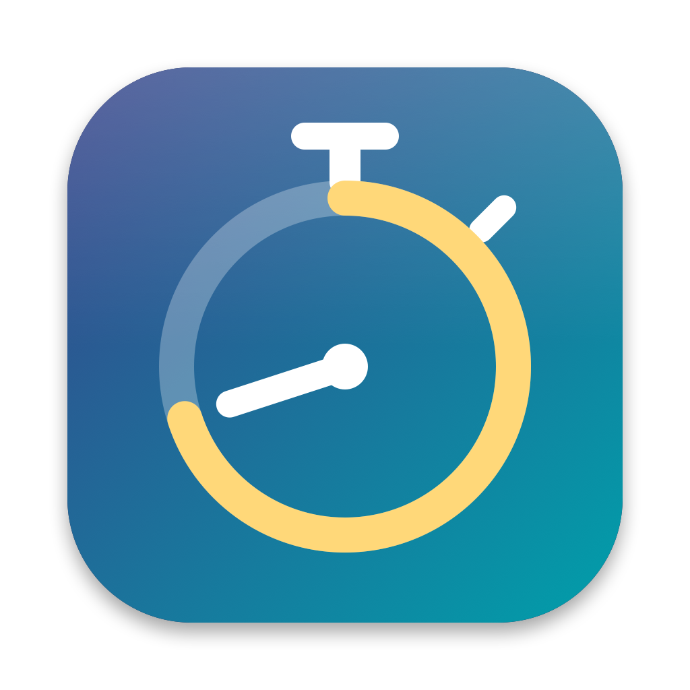
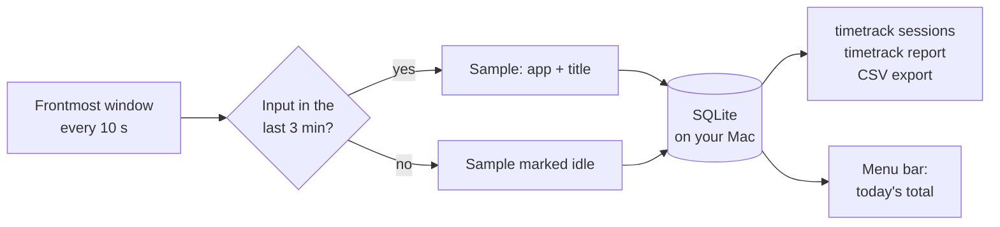

<p align="center">
  
</p>

<h1 align="center">TimeTrack</h1>

<p align="center">
  <strong>Friday, 4:45 pm. The timesheet is due. What did you do on Tuesday?</strong><br>
  TimeTrack remembers, so you don't have to.
</p>

<p align="center">
  
  
  
  
</p>

---

## The problem

Timesheets are written from memory, and memory is bad at this. By the end of the
week, "four hours on client work" is a guess, and the gap between the guess and
the truth is either unbilled time or a number you cannot defend.

Most trackers ask you to *remember to start a timer*. That is the same problem
moved earlier in the day.

## The idea

**Don't ask. Just watch the frontmost window.**

Every 10 seconds, TimeTrack notes which app and which window is in front, and
whether you were actually at the keyboard. That is all it records. When it is time
to fill in the timesheet, you ask for a day and get it back as blocks:

```text
$ timetrack sessions --day yesterday --min 10m

Blocks — 2026-09-25 (10m or longer)
───────────────────────────────────
09:02–10:41  1h 39m   Microsoft Teams — Weekly sync | Microsoft Teams
10:41–12:15  1h 34m   Visual Studio Code — Invoice.swift — billing-service
13:10–14:02  52m      Safari — Pull request 482 · billing-service
14:02–15:30  1h 28m   Visual Studio Code — Invoice.swift — billing-service

4 blocks, 5h 33m (5.55 h)
```

Totals come as `2h 45m` and as decimal hours (`2.75`), because that is what
timesheets want. The blocks above are illustrative; yours come from your own day.

## How it works



Two pieces, one database:

- **`TimeTrackBar.app`** — the menu bar app. Shows today's running total, pauses
  recording, exports CSV. It runs the sampler itself, so this is the one you
  normally want.
- **`timetrack`** — the CLI. Prints the reports, and can run the sampler headless
  if you would rather have no menu bar icon.

A locked screen counts as idle, so a Mac left unattended is never logged as work.

## Privacy, by design

Window titles are the most useful thing this records, and also the most sensitive.
So the defaults lean cautious:

- **Everything stays on your Mac.** One SQLite file, no network code, nothing uploaded.
- **Private apps record the app name only.** 1Password, Bitwarden, Keychain Access,
  Messages, WhatsApp, Signal and Telegram never have their titles stored.
- **You decide the rest.** Ignore an app entirely, strip patterns out of titles
  with regexes, or turn titles off — see [Settings](#settings).
- **Plain SQLite, no lock-in.** Query it yourself, prune it, delete it.

## Install

Requires macOS 13 or later.

<!-- Uncomment when the cask is published in augustose/homebrew-tap:

### Homebrew

```sh
brew trust augustose/tap
brew install --cask augustose/tap/timetrack
```

Installs `TimeTrackBar.app` and the `timetrack` command. Then jump to
[Grant Accessibility permission](#grant-accessibility-permission).

### From source

Needs the Xcode command line tools.
-->

```sh
git clone https://github.com/augustose/timetrack.git
cd timetrack
make install
```

That builds both targets, puts `timetrack` in `~/.local/bin`, installs
`TimeTrackBar.app` into `/Applications`, and registers a login agent so the
menu bar app starts with your session.

### Grant Accessibility permission

Window titles come from the macOS Accessibility API, which is permission-gated:

1. **System Settings › Privacy & Security › Accessibility**
2. Enable **TimeTrackBar** (and **timetrack** if you run the CLI sampler).

Without it you still get app names — you just lose the titles, which are the
part that tells you *which* client or ticket you were on.

### Make the permission stick across rebuilds

macOS ties that grant to the binary's code signature, so an ad-hoc signed
rebuild looks like a new app and you get asked again. Create a stable identity
once:

```sh
make signing-help    # prints the Keychain Access steps
```

Name it `TimeTrack Self-Signed`, type *Code Signing*, *Self Signed Root*. The
Makefile picks it up automatically from then on.

## Making changes

After editing the source, one command rebuilds, reinstalls and restarts:

```sh
make dev          # or: ./scripts/dev-install.sh
```

It stops the running sampler first (overwriting `/Applications` while the app
runs leaves launchd pointing at a binary that no longer exists), rebuilds,
reinstalls both targets, re-bootstraps the login agent, and prints `timetrack
status` so you can see it came back up.

Options: `--cli-only`, `--no-agent`, `--reset-permission`.

### If window titles suddenly go blank after a rebuild

That is the Accessibility grant, not a bug in the sampler. macOS keys the grant
to the code signature, so an ad-hoc rebuild is a *different app* as far as TCC
is concerned — the entry stays checked in System Settings while granting
nothing. `make dev` warns you when the build is ad-hoc signed.

The permanent fix is the stable certificate (`make signing-help`). Until then:

```sh
./scripts/dev-install.sh --reset-permission
```

then re-approve TimeTrackBar when it asks.

## Daily use

```sh
timetrack status                          # is it recording? how much today?
timetrack today                           # time per app today
timetrack today --titles                  # ...and per window title
timetrack sessions --day yesterday        # chronological blocks — the timesheet view
timetrack sessions --min 10m              # only blocks of 10 minutes or more
timetrack report --week --titles          # last 7 days
timetrack export --day today --sessions -o ~/Desktop/today.csv
timetrack pause / timetrack resume
```

`sessions` is the one you want when filling a timesheet: it collapses the raw
10-second samples into contiguous blocks with start and end times.

Every duration is printed twice — as `2h 45m` and as decimal hours (`2.75`),
because timesheets usually want the decimal.

## Settings

`~/.config/timetrack/config.json`, re-read automatically when you save it:

| Key | Default | What it does |
| --- | --- | --- |
| `intervalSeconds` | `10` | How often to sample |
| `idleThresholdSeconds` | `180` | No input for this long marks the sample idle; idle samples are excluded from reports unless you pass `--include-idle` |
| `recordTitles` | `true` | Master switch for window titles |
| `privateApps` | 1Password, Bitwarden, Keychain Access, Messages, WhatsApp, Signal, Telegram | Only the app name is recorded, never the title |
| `ignoredApps` | `[]` | Not recorded at all |
| `redactPatterns` | `[]` | Regexes stripped from titles before storage |
| `maxTitleLength` | `300` | Titles longer than this get truncated |
| `dayStartHour` | `0` | Set to `4` if you work past midnight and want 1am to count as the previous day |
| `menuBarSymbol` | `stopwatch` | SF Symbol for the menu bar icon — see below |

App matching is case-insensitive against both the app name and its bundle ID,
and a trailing `*` is a wildcard:

```json
"privateApps": ["1Password", "com.apple.mail", "Bank*"]
```

The screen lock counts as idle, so a locked Mac is never logged as work.

## The menu bar icon

The icon carries state, so you can tell what TimeTrack is doing without opening
the menu:

| State | What you see |
| --- | --- |
| Recording | The symbol plus today's running total, e.g. `3h 12m` |
| Paused | The same symbol dimmed, with the word `paused` |
| Permission missing | A warning triangle — a different glyph, not a badge, because badges are illegible at menu bar size |

VoiceOver reads the spelled-out version ("TimeTrack, recording, 3 hours 12
minutes recorded today") rather than the abbreviated title.

Change the symbol in `config.json` — no rebuild needed, it applies next time the
menu bar refreshes. Ones that hold up at 16 points:

| Symbol | Reads as |
| --- | --- |
| `stopwatch` | Time being measured. Default — the crown and side button make the silhouette distinctive |
| `timer` | Clock face with tick marks; cleaner but closer to a plain clock |
| `hourglass` | Time passing; very distinct outline, slightly passive |
| `macwindow` | Literally what is being logged — the frontmost window |
| `calendar.badge.clock` | Timesheet framing; busiest of the set |
| `chart.bar.xaxis` | The reports rather than the recording |
| `deskclock` | Alarm clock; distinct, but reads more like a reminder app |
| `clock.arrow.circlepath` | History of what happened |

An unknown name silently falls back to `stopwatch`, so a typo cannot leave you
with a blank menu bar item.

## Where things live

| | |
| --- | --- |
| Database | `~/.local/share/timetrack/track.db` (SQLite, WAL) |
| Config | `~/.config/timetrack/config.json` |
| Logs, lock, pause flag | `~/.local/state/timetrack/` |
| Login agent | `~/Library/LaunchAgents/ca.senet.timetrackbar.plist` |

The database is plain SQLite, so you can query it directly:

```sh
sqlite3 ~/.local/share/timetrack/track.db \
  "SELECT app, SUM(interval_s)/3600.0 h FROM samples
   WHERE day = date('now') AND idle = 0
   GROUP BY app ORDER BY h DESC;"
```

Keep it from growing forever:

```sh
timetrack prune --older-than 90
```

## Headless instead of the menu bar

If you would rather have no menu bar icon, skip `install-app` and use the
CLI sampler under launchd — see the comment at the top of
`scripts/ca.senet.timetrack.plist.in`. Only one sampler runs at a time; they
coordinate through a lock file, and the menu bar app falls back to
display-only if the daemon already holds it.

## Uninstall

```sh
make uninstall     # removes the agent, the app and the CLI
rm -rf ~/.local/share/timetrack ~/.config/timetrack ~/.local/state/timetrack
```
